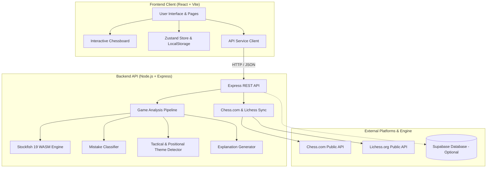

# ♟️ ChessMind — Architecture & File Guide

> **Personalized Chess Improvement Engine**  
> Complete technical breakdown of every file, component, service, and data flow across both the Frontend and Backend repositories.

---

## 🏛️ High-Level System Architecture



---

## 🎨 Part 1: Frontend Repository (`Chess-Mind-Frontend`)

### 1. Root & Configuration
| File | Role | Purpose & Capabilities |
| :--- | :--- | :--- |
| [`index.html`](file:///c:/Users/91981/Desktop/Chess%20Mind/index.html) | Root HTML Document | Mounts the React application into `<div id="root">`, sets page metadata, and imports Google Fonts (`Inter`, `Space Grotesk`, `JetBrains Mono`). |
| [`package.json`](file:///c:/Users/91981/Desktop/Chess%20Mind/package.json) | Dependency Manifest | Defines client dependencies: React 19, Vite 8, `react-chessboard`, `chess.js`, `lucide-react`, `zustand`, and `react-router-dom`. |
| [`vite.config.js`](file:///c:/Users/91981/Desktop/Chess%20Mind/vite.config.js) | Bundler Config | Configures Vite build settings, dev server, and React Fast Refresh plugin. |
| [`.gitignore`](file:///c:/Users/91981/Desktop/Chess%20Mind/.gitignore) | Git Rules | Excludes `node_modules/`, `dist/`, `.env`, and the separate `server/` folder from the frontend repository. |
| [`README.md`](file:///c:/Users/91981/Desktop/Chess%20Mind/README.md) | Client Documentation | GitHub landing page documentation with setup commands, feature highlights, and deployment guide. |

---

### 2. Core Setup & Design System
| File | Role | Purpose & Capabilities |
| :--- | :--- | :--- |
| [`src/main.jsx`](file:///c:/Users/91981/Desktop/Chess%20Mind/src/main.jsx) | React Application Entry | Initializes the React DOM root and wraps the entire application with `BrowserRouter`. |
| [`src/App.jsx`](file:///c:/Users/91981/Desktop/Chess%20Mind/src/App.jsx) | Master Routing | Defines application routes: `/` (Home), `/connect`, `/games`, `/analysis`, `/training`, `/grandmaster`, `/profile`. |
| [`src/index.css`](file:///c:/Users/91981/Desktop/Chess%20Mind/src/index.css) | Global Design System | Full custom CSS system: dark chess palette, glassmorphism, responsive `.board-two-col` grid for mobile viewports, and custom animations. |

---

### 3. State Management & API Layer
| File | Role | Purpose & Capabilities |
| :--- | :--- | :--- |
| [`src/store/useStore.js`](file:///c:/Users/91981/Desktop/Chess%20Mind/src/store/useStore.js) | Zustand Central Store | **The App's Memory**. Persists user profile, games list, training history, and weakness levels (*Needs Practice* → *Improving* → *Strong*) to `localStorage`. Automatically computes the **Current Improvement Focus**. |
| [`src/services/api.js`](file:///c:/Users/91981/Desktop/Chess%20Mind/src/services/api.js) | HTTP Client Service | **The Bridge**. Centralized `fetch` wrapper calling backend endpoints. Uses `VITE_API_URL` when deployed or defaults to `http://localhost:3001/api`. |

---

### 4. Reusable UI Components
| File | Role | Purpose & Capabilities |
| :--- | :--- | :--- |
| [`src/components/Chessboard/InteractiveBoard.jsx`](file:///c:/Users/91981/Desktop/Chess%20Mind/src/components/Chessboard/InteractiveBoard.jsx) | Interactive Chessboard | Wraps `react-chessboard`. Handles drag-and-drop, click-to-move, legal move highlights, board orientation flipping, and `touchAction: none` to prevent screen sliding on mobile. |
| [`src/components/Layout/Layout.jsx`](file:///c:/Users/91981/Desktop/Chess%20Mind/src/components/Layout/Layout.jsx) | App Frame & Navigation | Sidebar navigation on desktop, slide-out drawer on mobile with backdrop overlay, and active account badge. |
| [`src/components/Toast/ToastContainer.jsx`](file:///c:/Users/91981/Desktop/Chess%20Mind/src/components/Toast/ToastContainer.jsx) | Notification System | Renders animated toast alert pills (success, error, info) for asynchronous operations. |

---

### 5. Application Screens (Pages)
| File | Route | Purpose & Capabilities |
| :--- | :--- | :--- |
| [`src/pages/Home/Home.jsx`](file:///c:/Users/91981/Desktop/Chess%20Mind/src/pages/Home/Home.jsx) | `/` | **Command Center Dashboard**. Displays rating summary, games imported, win rate, **Current Improvement Focus**, **Latest Coaching Insight**, and 1-click **Interactive Demo Mode**. |
| [`src/pages/ConnectProfile/ConnectProfile.jsx`](file:///c:/Users/91981/Desktop/Chess%20Mind/src/pages/ConnectProfile/ConnectProfile.jsx) | `/connect` | **Account Connection**. Connects public Chess.com or Lichess profiles without passwords and automatically imports recent match history. |
| [`src/pages/Games/Games.jsx`](file:///c:/Users/91981/Desktop/Chess%20Mind/src/pages/Games/Games.jsx) | `/games` | **Game Library**. Browsable list of all imported games with opponent names, openings, results, platform tags, search bar, and result filters. |
| [`src/pages/GameAnalysis/GameAnalysis.jsx`](file:///c:/Users/91981/Desktop/Chess%20Mind/src/pages/GameAnalysis/GameAnalysis.jsx) | `/analysis` | **Deep Move Replay**. Step through matches move-by-move with a dynamic Stockfish eval bar, mistake cards, engine best moves, keyboard arrows (`←`/`→`), and a **"Practice This Mistake"** button. |
| [`src/pages/Training/Training.jsx`](file:///c:/Users/91981/Desktop/Chess%20Mind/src/pages/Training/Training.jsx) | `/training` | **Interactive Practice Gym**. Recreates your exact mistake position on the board, provides instant move feedback, advances to similar tactical/positional exercises, and updates weakness progress. |
| [`src/pages/GrandmasterStudy/GrandmasterStudy.jsx`](file:///c:/Users/91981/Desktop/Chess%20Mind/src/pages/GrandmasterStudy/GrandmasterStudy.jsx) | `/grandmaster` | **Grandmaster Masterclass**. Interactive GM studies (Fischer vs Spassky, Carlsen vs Anand, Kasparov, Capablanca). Try your move on the board and compare it with the GM's decision. |
| [`src/pages/Profile/Profile.jsx`](file:///c:/Users/91981/Desktop/Chess%20Mind/src/pages/Profile/Profile.jsx) | `/profile` | **Weakness Intelligence Card**. Dynamic breakdown of themes (Forks, Pins, Pawn Structures, Weak Squares, Planning) showing progress states, stats, and a full **Training History log**. |

---

## ⚙️ Part 2: Backend Repository (`chess-mind-backend`)

### 1. Server Configuration & Database
| File | Role | Purpose & Capabilities |
| :--- | :--- | :--- |
| [`server/src/index.js`](file:///c:/Users/91981/Desktop/Chess%20Mind/server/src/index.js) | Server Main Entry | Boots Express on port 3001, configures CORS and JSON parsing, initializes the Stockfish 19 WASM engine, and binds all route handlers. |
| [`server/package.json`](file:///c:/Users/91981/Desktop/Chess%20Mind/server/package.json) | Backend Manifest | Defines backend dependencies: `express`, `stockfish`, `chess.js`, `axios`, `dotenv`, and `@supabase/supabase-js`. |
| [`server/supabase_schema.sql`](file:///c:/Users/91981/Desktop/Chess%20Mind/server/supabase_schema.sql) | Database Schema | PostgreSQL schema for Supabase: tables for `chess_accounts`, `games`, `move_analysis`, `player_profiles`, and `training_history`. |
| [`server/src/config/supabase.js`](file:///c:/Users/91981/Desktop/Chess%20Mind/server/src/config/supabase.js) | Supabase Client | Connects to Supabase when keys are provided; gracefully enables in-memory session mode when keys are omitted. |
| [`server/.env.example`](file:///c:/Users/91981/Desktop/Chess%20Mind/server/.env.example) | Environment Template | Public template documenting `PORT` and optional Supabase environment variables. |

---

### 2. API Route Handlers (`server/src/routes/`)
| File | Endpoint Prefix | Purpose & Capabilities |
| :--- | :--- | :--- |
| [`server/src/routes/profile.js`](file:///c:/Users/91981/Desktop/Chess%20Mind/server/src/routes/profile.js) | `/api/profile` | Connects Chess.com / Lichess profiles and returns account statistics and ratings. |
| [`server/src/routes/games.js`](file:///c:/Users/91981/Desktop/Chess%20Mind/server/src/routes/games.js) | `/api/games` | Fetches match archives from Chess.com or Lichess, preserves full PGNs, parses metadata, and handles duplicate filtering. |
| [`server/src/routes/analysis.js`](file:///c:/Users/91981/Desktop/Chess%20Mind/server/src/routes/analysis.js) | `/api/analysis` | Receives PGNs, runs the Stockfish analysis pipeline, caches results, and returns mistake classifications. |

---

### 3. Intelligence & Coaching Services (`server/src/services/`)
| File | Engine Service | Purpose & Capabilities |
| :--- | :--- | :--- |
| [`server/src/services/chesscom.js`](file:///c:/Users/91981/Desktop/Chess%20Mind/server/src/services/chesscom.js) | Chess.com API Client | Queries public Chess.com monthly game archives, extracts player colors, results, ratings, and opening names. |
| [`server/src/services/lichess.js`](file:///c:/Users/91981/Desktop/Chess%20Mind/server/src/services/lichess.js) | Lichess API Client | Streams user games from Lichess in NDJSON format and maps them into standard ChessMind game models. |
| [`server/src/services/stockfish.js`](file:///c:/Users/91981/Desktop/Chess%20Mind/server/src/services/stockfish.js) | Stockfish 19 WASM Engine | Wraps the multithreaded Stockfish 19 WASM engine. Evaluates positions in FEN notation, runs depth 12–16 searches, and extracts centipawn/mate scores. |
| [`server/src/services/gameAnalyzer.js`](file:///c:/Users/91981/Desktop/Chess%20Mind/server/src/services/gameAnalyzer.js) | Analysis Pipeline | Stepper that traverses every move of a game, computes evaluation differences ($\Delta\text{eval}$), and extracts blunder positions. |
| [`server/src/services/mistakeClassifier.js`](file:///c:/Users/91981/Desktop/Chess%20Mind/server/src/services/mistakeClassifier.js) | Error Categorizer | Classifies mistakes by evaluation loss:<br>• **Strategic**: $0.4 - 1.0$ pawns<br>• **Positional**: $1.0 - 2.0$ pawns<br>• **Tactical**: $> 2.0$ pawns |
| [`server/src/services/themeDetector.js`](file:///c:/Users/91981/Desktop/Chess%20Mind/server/src/services/themeDetector.js) | Board Geometry Detector | Analyzes board state to detect tactical patterns: **Forks**, **Pins**, **Skewers**, **Hanging Pieces**, **Missed Checks**, and **Pawn Structure Damaging Moves**. |
| [`server/src/services/explanationGenerator.js`](file:///c:/Users/91981/Desktop/Chess%20Mind/server/src/services/explanationGenerator.js) | AI Coaching Explainer | Generates plain-English coaching diagnostics: explains what the user played, why it was a problem, what the better move was, and what drill to study next. |

---

## 🔄 The Complete Improvement Loop in Action

```text
Connect Profile (Chess.com / Lichess)
           ↓
Fetch Game History & Parse PGNs
           ↓
Stockfish 19 Move-by-Move Evaluation
           ↓
Classify Errors: Strategic, Positional, Tactical
           ↓
Detect Specific Themes (Forks, Pins, Pawn Structures)
           ↓
Update Player Profile & Set Current Improvement Focus
           ↓
Recommend Targeted Training & Practice on Interactive Board
           ↓
Record Practice Performance & Advance Theme Status (Needs Practice → Improving → Strong)
           ↓
Study Grandmaster Games with Comparable Pawn Structures / Decisions
```
